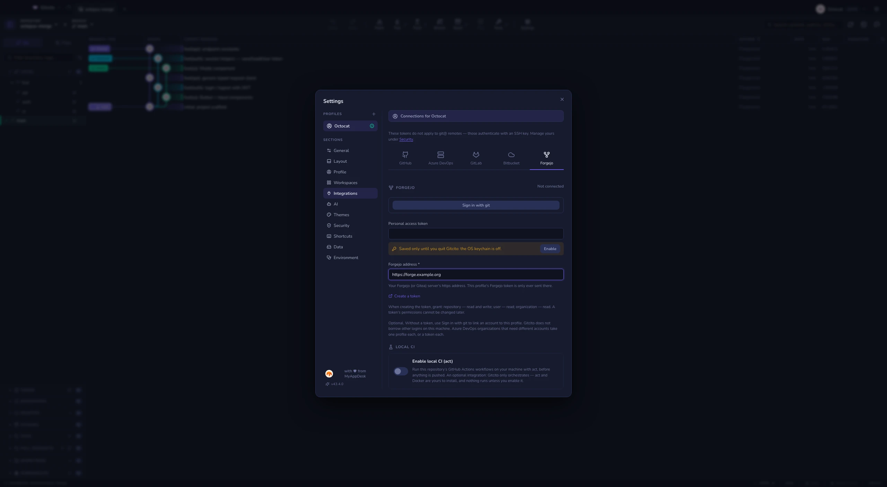

# الاستضافة وطلبات السحب

## الإنشاء

أنشئ طلب سحب (أو دمج) دون مغادرة التطبيق: قوائم منسدلة للفروع، وعنوان ومتن
معبَّآن مسبقًا من التزامات الفرع، ومفتاح للمسوّدة، و— على GitHub — مراجعون
وتسميات ومكلَّفون يُطبَّقون عند الإنشاء.

يعمل على **GitHub وGitLab وBitbucket وAzure DevOps**. وطلبات السحب/الدمج
المفتوحة للأربعة جميعًا مسرودة في الشريط الجانبي.

ابدأ واحدًا من مقارنة الفروع، أو من الرسم البياني، أو من `+` في لوحة طلبات
السحب، أو من مشكلة (فتُعبَّأ `Closes #N`).

## الكومات في القائمة

طلبات الدمج التي يجلس بعضها فوق بعض تنطوي في صف واحد يحمل أيقونة كومة، والفرع
الذي يحطّ عليه التسلسل، وعددها. وسّعه لترى التسلسل بترتيب القراءة — من القمة نزولًا إلى الأساس — مع سهم صغير تحت
كل صف يسمّي ما يُدمج فيه، فيصير الاتجاه أمامك بدل أن تستنتجه من أربعة أسس.

أمران يصنعان تلك المجموعة: رقم الكومة الخاص بـ GitHub حين تنتمي الطلبات إلى
[كومة أصلية](stacks.md)، وإلا فالمراجع نفسها — طلب دمج أساسه رأس طلب آخر يجلس
فوقه. والقاعدة الثانية هي ما يجعل هذا يعمل أيضًا على GitLab وBitbucket وAzure
DevOps.

يحمل كل صف حالة **الفحوص** الخاصة برأسه — مرّر المؤشر لترى الأعداد — وعلى GitHub
تظهر أيضًا المستويات المغلقة أو المدموجة سلفًا، وهي ما كانت قائمة الطلبات المفتوحة
لتخفيه. ويُعلَّم المستوى الذي فوق مستوى **مغلق** بأنه محجوب: قد تكون فحوصه خضراء،
لكن الفرع الذي يستهدفه لن يحطّ أبدًا. تظهر إجراءات الصف عند التمرير كي يحتفظ
العنوان بالعرض.

قراءة الفحوص تكلّف طلبًا واحدًا لكل طلب دمج، وعند تحديث القائمة فقط.

## طلبات السحب الخاصة بك في المستودع الأصل لنسخة متفرعة

في النسخة المتفرعة (fork)، تكون طلبات السحب المهمة عادةً هي التي فتحتها في المستودع الذي
تفرّعت منه، وهي موجودة هناك لا في نسختك. لذلك، حين يكون للمستودع بعيد `upstream` يشير إلى
مستودع GitHub مختلف عن `origin`، تسأل القائمة `upstream` أيضًا عن طلبات السحب المفتوحة
وتُبقي **فقط تلك التي يأتي فرعها من نسختك**. وتظهر تحت طلبات نسختك، تحت عنوان يحمل اسم
المستودع الأصل، **على owner/repo**. والنقر يفتح عرض التفاصيل نفسه، بفحوصه ومراجعته، في
المستودع الأصل.

*الحدود:* GitHub فقط، وبعيد اسمه `upstream` فقط. تُستبعد طلبات السحب الأخرى في المستودع
الأصل عن قصد: فتلك قائمة انتظاره، لا عملك. وتبقى الحزم والبحث عن الفروع تعمل على قائمة
`origin` وحدها. وجلب قائمة المستودع الأصل يكلّف طلبًا إضافيًا في كل تحديث.

## المراجعة — GitHub وGitLab

| | |
|---|---|
| **المحادثة** | التعليقات وحالة المراجعة |
| **الفحوص** | تشغيلات فحص التكامل المستمر (GitHub) أو مهام خط الأنابيب (GitLab) بحالات نجاح/فشل/انتظار وروابط لعرض السجلات |
| **الملفات المُطالَعة** | قائمة تحقق ✓ لكل ملف مع مؤشر تقدّم |
| **الخيوط المضمَّنة** | تعليقات الأسطر مجمَّعة بحسب `file:line`، والردود |
| **الإجراءات** | التعليق، والموافقة، وطلب تغييرات، والدمج / السحق |

وإن أرسل أحدهم قسريًا في منتصف المراجعة، أراك
[ما الذي تغيّر منذ](range-diff.md) بالضبط ما الذي تحرك.

فروق GitLab بصراحة: ليس لدى GitLab نداء واحد «لإرسال المراجعة»، لذا تستخدم
**الموافقة** نقطة نهاية الموافقات لديه، بينما **طلب التغييرات** يزيل موافقتك
وينشر تعليقك. و**الدمج بإعادة الأساس** غير معروض — إذ يقرر GitLab بين التزام
الدمج والتقديم السريع من إعدادات المشروع، ولذا لا تعرض قائمة الدمج سوى الدمج
والسحق. والخيوط المضمَّنة تعرض الملف والسطر لكن دون قطعة الفرق المحيطة، لأن
واجهة GitLab البرمجية لا تعيدها. وتعمل المراجعة/الدمج للمشاريع على
**gitlab.com**؛ أما النسخ المستضافة ذاتيًا فليست مدعومة بعد. ولا تزال Bitbucket
وAzure DevOps تُفتحان في المتصفح للمراجعة.

## GitLab المُدار ذاتيًا

لـ GitLab الخاص بالشركة عنوانه الخاص. أعطِ ملفًا شخصيًا هذا العنوان في **الإعدادات ←
التكاملات ← GitLab ← عنوان GitLab**، مثل `git.example.org` أو
`https://example.net/gitlab` إن كان يُقدَّم تحت مسار. من ذلك الحين تُعد البعائد على ذلك
المضيف GitLab: تُعرض طلبات الدمج وتُفتح وتُراجع وتُدمج، ويتواصل متصفح الاستنساخ و*إنشاء
مستودع* معه، ويسجّل push وfetch الدخول برمز ذلك الملف الشخصي.

**رمز GitLab ينتمي إلى نسخة واحدة.** يُرسل رمز الملف الشخصي فقط إلى العنوان الذي يحدده ذلك
الملف. والعنوان الفارغ يعني gitlab.com. لا يصل رمز gitlab.com أبدًا إلى خادم الشركة، ولا
يصل رمز الشركة أبدًا إلى gitlab.com. إن كان حسابا العمل والشخصي على نسختين مختلفتين، فأعطِ
كلًا منهما ملفه الشخصي. والمستودع المرتبط بملف شخصي يستخدم نسخة ذلك الملف.

**إنشاء رمز** يفتح صفحة الرموز في نسختك مع تحديد `api` و`write_repository` مسبقًا. الرمز
للقراءة فقط يتصل بلا مشكلة ثم يفشل عند أول push.

الحدود:

- **https فقط.** يُرفض عنوان `http://` عادي، لأن الرمز كان سيعبر الشبكة نصًا واضحًا.
- **نسخة GitLab واحدة لكل ملف شخصي.** أضف ملفًا شخصيًا ثانيًا لنسخة ثانية.
- عبر ssh يُقارن المضيف لا المسار، فلا يمكن التمييز بين نسختين على مضيف واحد بمسارين
  مختلفين لبعيد ssh.
- تُرسم صور البعائد فقط لـ gitlab.com وgithub.com. ويحصل البعيد المُدار ذاتيًا على
  الأيقونة العادية، حتى لا تُرسل أسماء مجموعاته أبدًا إلى مضيف عام.

## Forgejo

اضبط عنوان النسخة قبل إدخال رمزها. تغيير العنوان يمسح تسجيل الدخول السابق.

يعمل Forgejo — وGitea الذي يشاركه الواجهة البرمجية نفسها — دائمًا على عنوان اختاره
مالكه: خادمك الخاص، أو خادم عام مثل codeberg.org. أعطِ ملفًا شخصيًا هذا العنوان في
**الإعدادات ← التكاملات ← Forgejo**، مع رمز وصول. **إنشاء رمز** يفتح صفحة الرموز في ذلك
الخادم. امنح الرمز صلاحية القراءة والكتابة على *repository*، والقراءة على *user*
و*organization*.

من ذلك الحين تُعد البعائد على ذلك الخادم Forgejo:

| يعمل | كيف |
|------|-----|
| Push وfetch | بتسجيل الدخول برمز الملف الشخصي |
| طلبات السحب المفتوحة | تُعرض في الشريط الجانبي وتُفتح في [صفحة طلب السحب](#المراجعة--github-وgitlab): المحادثة، وفرق كل ملف، والفحوص (حالات الإيداع، بما فيها Forgejo Actions)، والتعليق، والموافقة، وطلب التغييرات، وmerge / squash / rebase |
| إنشاء طلب سحب | من التطبيق؛ وتحمل المسودة البادئة `WIP:` التي يستخدمها Forgejo |
| متصفح الاستنساخ، إنشاء مستودع | على ذلك الخادم، تحت حسابك أو منظمة |

كما في GitLab، **لا يذهب رمز Forgejo إلا إلى الخادم الذي أصدره**. والملف الشخصي بلا عنوان
Forgejo ليس له أي بيانات اعتماد لـ Forgejo. ولا يوجد خادم افتراضي يُرجع إليه.

الحدود:

- تُعرض سلاسل تعليقات الأسطر، لكن لا يمكن الرد عليها من التطبيق: ليس في Forgejo واجهة
  برمجية للرد داخل سلسلة قائمة. ردّ على الخادم.
- https فقط، وخادم Forgejo واحد لكل ملف شخصي.
- تتوقف القوائم بعد عشرين طلبًا: 1,000 طلب سحب أو مستودع بحجم الصفحة الافتراضي للخادم.

## المشكلات والمعالم والإصدارات — GitHub

تصفّح المشكلات وافتح تبويب مشكلة كاملًا: المتن، والتعليقات، والتسميات،
والمكلَّفون، والمعلم، وحقول Projects v2، والإغلاق/إعادة الفتح، و**أنشئ فرعًا لهذه
المشكلة** (بتسمية من الذكاء الاصطناعي). والمعالم تعرض تقدّمها ومشكلاتها.
والإصدارات قابلة للتصفح مع صفحة سجل تغييرات.

## بانتظار مراجعتك

في قائمة طلبات السحب في الشريط الجانبي، تميّز 👁 الطلبات التي تكون **أنت** فيها مراجعًا
ولم تردّ بعد — على GitHub وGitLab وForgejo على حد سواء. يُسأل المضيف عمّن تكون «أنت»
ببيانات اعتماد الملف الشخصي، ويُحفظ ذلك عشر دقائق. والرمز الذي لا يستطيع قراءة مستخدمه
(بلا `read:user` على Forgejo مثلًا) لا يميّز شيئًا.

## الإشعارات — GitHub

صندوق واردك كله — طلبات المراجعة، والإشارات، ونشاط التكامل المستمر — عبر كل
مستودع، مع مرشحات لغير المقروء/الكل وتعليم كمقروء. وجرس شريط الأدوات يحمل شارة
غير مقروء، وتنطلق إشعارات سطح مكتب اختيارية حين تُطلب مراجعة أو ينتهي التكامل
المستمر.

## الرموز

رموز لكل ملف شخصي لعدة حسابات أو منظمات، مخزَّنة في سلسلة مفاتيح نظامك. ويستطيع
Gitcito أيضًا أن يستعير ما يحمله **مساعد بيانات الاعتماد** لديك أصلًا، فالمنظمة
التي استوثقت منها بالفعل لا تحتاج غالبًا إلى أي إعداد إطلاقًا. انظر
[الأمان والأسرار](security.md).

كل ملف شخصي **يربط حسابه الخاص**. في الإعدادات ← التكاملات، يبحث زر **تسجيل
الدخول عبر git** عن تسجيل دخول موجود أصلًا على الجهاز — في credential helper
الخاص بـgit، ثم الحساب النشط في **GitHub CLI**، ثم نافذة تسجيل الدخول الخاصة
بالـhelper — ويربط ذلك الحساب بالملف الشخصي. لا يُشارَك شيء ضمنيًا: يبدأ الملف
الشخصي الجديد غير متصل، ويُرفض الحساب الذي ربطه ملف شخصي آخر بالفعل. لربط حساب
GitHub ثانٍ، أضفه إلى gh (`gh auth login`)، واجعله نشطًا (`gh auth switch`)، ثم
سجّل الدخول من الملف الشخصي الآخر — أو الصق رمز ذلك الحساب. لا يطلب git أبدًا
اسم المستخدم وكلمة المرور في الطرفية.

تُظهر الصفحة ما إذا كان الاتصال هو رمز الملف الشخصي أو ربطه بـhelper الخاص بـgit
أو ربطه بـGitHub CLI، و**قطع الاتصال** يلغي ذلك لهذا الملف الشخصي فقط: يُمسح
الرمز (ويبقى صالحًا لدى المستضيف حتى تلغيه هناك)، ويُزال الربط (ويبقى تسجيل
الدخول في gh أو في الـhelper).

تستخدم واجهة API لدى المستضيف — طلبات السحب والمشكلات وCI — وكذلك fetch وpull وpush
الخاصة بـgit نفسه عبر https رمزَ الملف الشخصي أو حسابه المرتبط. تصل بيانات الاعتماد
إلى git لذلك الأمر وحده، ومقصورةً على مضيف المستودع البعيد، ولا تُكتب أبدًا في
`.git/config`. أما الملف الشخصي الذي لا يملك أيًّا منهما فيترك git لـcredential
helper الخاص به. تُربط Azure DevOps وGitLab وBitbucket عبر credential helper الخاص
بـgit — إذ يحتفظ Git Credential Manager بعدة حسابات لكل مستضيف — أو تستخدم رمزًا لكل
ملف شخصي. يحدّد الربط حسابًا واحدًا لكل مستضيف، لذا تحتاج المؤسسات التي تتطلب حسابات
مختلفة إلى ملف شخصي لكل منها.

**انظر أيضًا:** [الفروع المكدَّسة](stacks.md) · [ميزات الذكاء الاصطناعي](ai.md)
